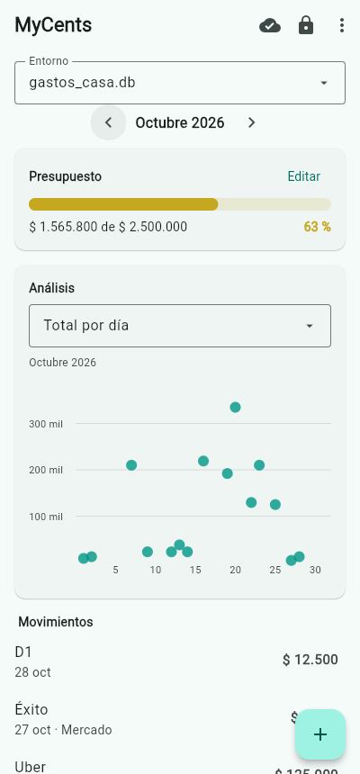

# MyCents

[Español](README.md) · **English**

**Local-first personal finance.** Each environment is a SQLite file that lives on your device;
Google Drive only receives a copy when you switch environments or close the app.

**Status:** complete app for Windows and Android from a single codebase (Flet). Windows and sync were
tested against real Google Drive; Android has not yet been tested on a physical phone.



*Sample data generated with `tools/demo_web.py`.*

## MVC architecture

```
src/finanzas/
├── models/     MODEL · knows nothing about UI or Drive
│   ├── database.py   ★ connections, read-only mode, transactions, snapshots
│   ├── repository.py ★ expenses, budget and aggregate queries
│   ├── security.py   ★ bcrypt, edit sessions, lockout after failed attempts
│   └── schema.sql + migrations/
├── services/   MODEL · outside world
│   ├── drive_auth.py      desktop and device OAuth, tokens in the OS keychain
│   ├── drive_gateway.py ★ Drive API v3 behind a protocol
│   └── sync_engine.py   ★ sync matrix and environment switching
└── ui/
    ├── controller.py ★ CONTROLLER · no Flet import, tested on its own
    └── app.py          VIEW · Flet screens and dialogs
```

## Technical decisions

- **Read-only enforced by SQLite** (`mode=ro`, `query_only=ON`); editing requires a 5-minute `EditSession`.
- **Money as integer cents**, converted with `Decimal`; `float` is rejected.
- **Analytics with `GROUP BY` on a covering index, never Pandas.**
- **File-based migrations**, each in its own transaction; a test proves new and migrated schemas are identical.
- **Sync never merges.** Snapshot fingerprint + Drive `headRevisionId`:

| Local | Drive | Action |
|---|---|---|
| unchanged | unchanged | nothing (metadata query only) |
| changed | unchanged | upload |
| unchanged | changed | download on open |
| changed | changed | conflict — nothing is overwritten; you choose (keep local / remote / both) |

- **Atomic downloads** validated with MD5, `integrity_check`, `foreign_key_check` and environment id.
- **`drive.file` as the only permission**; refresh token stored in the OS credential store.

## Measured results

Synthetic database with 1,000,000 expenses over 10 years (104 MB), full monthly view:

| Method | Time | Extra memory | Rows in Python |
|---|---:|---:|---:|
| SQL with covering index | **11 ms** | ~0 MB | 7,386 |
| `SELECT *` into Pandas and filter | 1,133 ms | 364 MB | 1,000,000 |

## Usage

```powershell
pip install -e ".[dev]"
python src/main.py           # or double-click MyCents.bat
flet build apk               # Android build
python tools/demo_web.py     # UI preview without Google, at http://127.0.0.1:8550
pytest                       # 195 tests
```

Google Drive setup requires two OAuth clients (desktop + TV/limited-input) placed in `src/secrets/`
— they are git-ignored and never committed.

## Limitations

The `.db` file is not encrypted yet (the PIN protects the app, not the file); Android untested on a
phone; Drive API v3 has no conditional upload, so a narrow last-writer-wins race exists (Drive keeps
~30 days of revisions); one open `.db` per device — no concurrent multi-user merge.

---
Personal portfolio project by **Johan Esteban García Bautista** · MIT License
