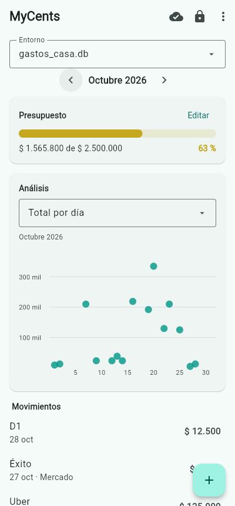

[README.md](https://github.com/user-attachments/files/34455745/README.md)
# Finanzas Local

Finanzas personales local-first. Cada entorno es un archivo SQLite que vive en tu
equipo; Google Drive solo recibe una copia al cambiar de entorno o al cerrar la app.

**Estado:** app completa para Windows y Android con una sola base de código (Flet).
Windows y la sincronización se probaron contra Google Drive real; Android todavía no se
ha probado en un teléfono.



*Datos de ejemplo generados con `tools/demo_web.py`.*

## Arquitectura MVC

```
finanzas-local/
├── pyproject.toml              Dependencias y configuración de `flet build`
├── Finanzas.bat                Abre la app en Windows sin consola
├── src/
│   ├── main.py                 Punto de entrada (Windows y Android)
│   ├── secrets/                JSON de Google Cloud; viajan dentro del APK
│   └── finanzas/
│       ├── models/             MODELO · no conoce la interfaz ni Drive
│       │   ├── schema.sql          DDL v1
│       │   ├── migrations/         v2: categoría e índice de análisis
│       │   ├── database.py    ★    Conexiones, lectura ro, transacciones, snapshot
│       │   ├── repository.py  ★    Gastos, presupuesto y consultas agregadas
│       │   ├── security.py    ★    bcrypt, sesión de edición y bloqueo por intentos
│       │   └── entities.py         Dinero, fechas y objetos de dominio
│       ├── services/           MODELO · mundo exterior
│       │   ├── drive_auth.py       OAuth de escritorio y de dispositivo, tokens
│       │   ├── drive_gateway.py ★  Drive API v3 detrás de un protocolo
│       │   ├── sync_engine.py ★    Matriz de sincronización y cambio de entorno
│       │   └── local_state.py      Estado por equipo que no viaja con el .db
│       └── ui/
│           ├── controller.py  ★    CONTROLADOR · sin Flet, probado aparte
│           ├── formatting.py       Pesos colombianos, meses y color del presupuesto
│           └── app.py              VISTA · pantallas y diálogos en Flet
├── tests/                      Modelo, sincronización, OAuth y controlador
└── tools/                      Benchmark, prueba con Drive real y demo web
```

```
app.py ──asyncio.to_thread──▶ controller.py ──▶ models / services
app.py ◀──datos planos── controller.py (solo si la generación sigue vigente)
```

**Flet en lugar de PyQt6.** Con Android como destino, PyQt6 deja de servir. Flet corre
el mismo Python en Windows y Android y empaqueta un APK con `flet build apk`; `bcrypt` y
`cryptography` tienen ruedas para Android en su repositorio. El Scatter Plot usa
`flet-charts` (nativo, con tooltips) en vez de Matplotlib, que en un teléfono pesa más.

**El controlador no importa Flet.** Toda la lógica de pantalla (PIN, entorno activo, modo
sin conexión, conflictos) se prueba con un Drive en memoria. La vista solo dibuja y
llama al controlador fuera del hilo de eventos.

## Decisiones técnicas

**Solo lectura impuesto por SQLite.** Las consultas abren con `mode=ro` y
`query_only=ON`. Editar, borrar o cambiar el presupuesto exige una `EditSession`, que
vence a los 5 minutos y vale para un solo `entorno_id`.

**Dinero en centavos enteros.** Evita el error de redondeo de `REAL`. La conversión
usa `Decimal` y rechaza `float`.

**Solo la fecha, sin hora.** La interfaz pide el día (DD/MM/AAAA, hoy por defecto) y lo
guarda a las 00:00 en hora local. El calendario de Flet entrega la medianoche local en UTC;
se convierte de vuelta para que en Bogotá no se guarde el día anterior.

**El mes es un rango sobre un índice, sin columnas generadas.** La primera versión usaba
`mes` y `dia` generadas, y las pruebas mostraron que el índice dejaba de ser cubriente:
SQLite trata cualquier referencia a una columna generada como lectura de toda la fila.
Desde la v2, `ix_gasto_analitica (ocurrido_en, total_cent, lugar_id, categoria_id)`
responde totales por día, mes, lugar o categoría sin tocar la tabla.

**Análisis con `GROUP BY`, nunca con Pandas.** La tarjeta de análisis tiene cinco vistas:

| Vista | Gráfica | Periodo |
| --- | --- | --- |
| Total por día | Dispersión: un punto por día con el total consolidado | Mes elegido |
| Total por mes | Dispersión: un punto por mes | Año del mes elegido |
| Por categoría · lugar · producto | Barras horizontales, de mayor a menor, con % del total | Mes o año |

Las barras muestran las 7 primeras y suman el resto en "Otros". "Por producto" solo cuenta
lo registrado como ítems. Los nombres se agrupan sin tildes ni mayúsculas ("Café" y "cafe"
son lo mismo).

**Migraciones por archivo.** `schema.sql` es la v1 y cada versión siguiente es un `.sql`
en `migrations/`, aplicado en su propia transacción. Una base creada hoy y una v1
migrada quedan con el mismo esquema exacto (hay una prueba que lo compara). Un equipo
con la app vieja rechaza abrir un archivo v2 en vez de dañarlo.

**`journal_mode = DELETE`.** Un solo escritor no gana nada con WAL, y así no hay
archivos `-wal` o `-shm` que puedan quedar fuera de una copia.

**Identidad en tres niveles para no mezclar entornos.** La ruta local usa el id de
Drive, no el nombre. Cada `.db` lleva un `entorno_id`, que también viaja como etiqueta
en Drive y se compara antes de subir o instalar. Al cambiar de entorno se descarta el
`ActiveEnvironment` entero, y `db.close()` hace fallar cualquier consulta tardía.

**La sincronización nunca fusiona.** Se compara la huella del snapshot con la última
base y `headRevisionId` con la revisión base:

| Local | Drive | Acción |
| --- | --- | --- |
| Sin cambios | Sin cambios | Nada; solo una consulta de metadatos |
| Cambió | Sin cambios | Subir |
| Sin cambios | Cambió | Bajar al abrir |
| Cambió | Cambió | Conflicto: no se pisa nada y tú eliges |

Al conflicto se responde con `KEEP_LOCAL`, `KEEP_REMOTE` (lo local queda en `.bak`) o
`KEEP_BOTH` (lo local se sube como un entorno aparte).

**Cuándo se conecta.** Sube al cambiar de entorno y al cerrar. También consulta los
metadatos al abrir un entorno: sin eso, un segundo equipo trabajaría sobre datos viejos
y cada sesión terminaría en conflicto. Si no hay red, la app sigue con la copia local.

**Descargas atómicas.** El archivo llega a una carpeta temporal, se valida con MD5,
`integrity_check`, `foreign_key_check` y `entorno_id`, y solo entonces reemplaza al
actual. Una descarga dañada no toca los datos.

**`drive.file` como único permiso.** La app crea la carpeta `Finanzas Local` y lista su
contenido. Un `.db` subido a mano se entrega una vez con el selector de Google
(`pick_drive_files` + `link_picked_file`). El refresh token va en el almacén de
credenciales del sistema, no en un `token.json`.

## Configurar Google Drive

En el mismo proyecto de Google Cloud se necesitan dos clientes OAuth:

| Archivo | Tipo de cliente | Plataforma | Cómo inicia sesión |
| --- | --- | --- | --- |
| `client_secret.json` | Aplicación de escritorio | Windows | Navegador del PC |
| `client_secret_tv.json` | TV y dispositivos de entrada limitada | Android | Código en google.com/device |

Android usa el flujo de dispositivo porque Google no admite la redirección a un puerto
local en Android, y ese flujo sí acepta `drive.file`. Ambos JSON van en `src/secrets/`.

En estado **Testing**, el token vence a los 7 días y la app vuelve a pedir inicio de
sesión, sin perder datos. Publicar la app (**In production**) lo evita, pero Google pide
datos adicionales antes de permitirlo.

## Uso

**Windows**

```powershell
python -m venv .venv
.venv\Scripts\activate
pip install -e ".[dev]"
python src/main.py          # o doble clic en Finanzas.bat
```

**Android** (se compila desde Windows; la primera vez descarga Flutter, JDK y Android SDK)

```powershell
flet build apk
```

El APK queda en `build\apk\`. Se copia al teléfono y se instala permitiendo apps de
origen desconocido.

**Sin Google**, para revisar la interfaz: `python tools/demo_web.py` y abrir
`http://127.0.0.1:8550`.

## Resultados medidos

Base sintética de 1 000 000 gastos en 10 años (104 MB), una VM Linux de 2 vCPU. Vista
mensual completa: Scatter Plot y barra de presupuesto.

| Método | Tiempo | Memoria adicional | Filas en Python |
| --- | ---: | ---: | ---: |
| SQL con índice cubriente | 11 ms | ~0 MB | 7 386 |
| `SELECT *` a Pandas y filtrar | 1 133 ms | 364 MB | 1 000 000 |

Ambos dieron el mismo total. Con un uso personal, la reducción de filas por `GROUP BY`
será mínima porque pocas compras caen en el mismo grupo. La ganancia real viene de leer
un mes por índice. A este ritmo de ~100 bytes por gasto, 10 años con 5 gastos diarios
ocuparían unos 2 MB, que es lo que se sube en cada sincronización.

`python tools/benchmark.py --rows 1000000` lo reproduce.

## Limitaciones

- **El `.db` no está cifrado.** Google y cualquiera con acceso al archivo pueden leerlo
  en un cliente SQLite, y Drive solo protege el transporte y su propio almacenamiento.
  `SyncEngine` sube siempre un snapshot temporal, así que el cifrado se puede agregar
  ahí, pero aún no existe.
- **El PIN protege la app, no el archivo.** bcrypt es un hash, no cifrado. Con costo 12,
  probar los 10 000 PIN toma unos 38 minutos en un solo núcleo de esta VM. El bloqueo por
  intentos solo aplica dentro de la app. Con una contraseña la barrera es mucho mayor.
- **Probado contra Google real solo en parte.** En Windows con Python 3.11 funcionaron:
  OAuth, el token guardado en el Administrador de credenciales, la carpeta propia, la
  subida, la descarga entre dos carpetas locales y el selector de Google. Faltan un
  segundo PC físico y un conflicto real.
- **Android sin probar en un teléfono.** La interfaz se revisó en modo web con
  capturas, y el flujo de dispositivo con respuestas simuladas. Queda por confirmar que
  el APK compile, que Google acepte el cliente de TV y que ese cliente vea los archivos
  creados desde Windows. Google asocia `drive.file` a la aplicación, por lo que se espera
  que sí, pero no está comprobado. Si no los ve, `FINANZAS_AUTH=device` hace que Windows
  use el mismo cliente.
- **Android sincroniza al pasar a segundo plano**, no solo al cerrar: el sistema puede
  terminar la app sin aviso. Sin cambios locales no usa la red.
- **En Android el token se guarda en un archivo** del almacenamiento privado de la app,
  porque Python no tiene acceso al llavero del sistema.
- **Ventana de carrera al subir.** Drive API v3 no expone un ETag para subir de forma
  condicional. Si otro equipo sube entre la consulta y la subida, gana la última. Drive
  conserva las revisiones anteriores unos 30 días, por lo que sería recuperable.
- **Un `.db` abierto por equipo.** La sincronización reemplaza el archivo completo, por
  lo que no combina cambios simultáneos de dos personas.

## Pruebas

```bash
pip install -e ".[dev]"
pytest
```

185 pruebas en Python 3.13 con SQLite 3.53 (la capa de datos también en 3.10).
